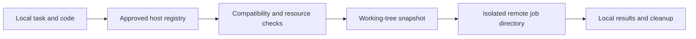

<div align="center">

# Remote Dev

**Give your coding agent more room to build and test.**

Use your existing SSH machines for development tasks when local CPU, memory, or disk is constrained.

[](https://github.com/hnewcity/remote-dev/actions/workflows/tests.yml)
[](#quick-start)
[](LICENSE)
[](#permissions-and-privacy)

[](README.md)
[](docs/README.zh-CN.md)

[Quick start](#quick-start) · [Install as a skill](#install-as-a-skill) · [Example workflow](#example-workflow) · [How it works](#how-it-works)

</div>

## Why this exists

Several coding-agent sessions can fill a laptop's RAM, saturate its CPU, and grow dependency caches at the same time. A Linux box, spare Mac, or VM may have capacity available, but an SSH address alone does not tell an agent whether it should use that machine.

Remote Dev adds a guided enrollment step and a reusable host registry. You choose which machines may receive project source and what they may do. The agent then matches a task to a compatible host, checks current resources, sends a code snapshot, runs the command, and brings the results back.

This offloads **tool execution**: builds, tests, benchmarks, and analysis scripts. It does not accelerate remote model inference. Small checks can stay local when synchronization would cost more than it saves.

> No hosts are enabled by default. Discovering an SSH alias or successfully logging in does not grant permission to run development tasks there.

## What you get

- **Guided setup:** discover explicit SSH Config aliases, inspect candidates, and remember allowed or denied hosts.
- **An English JSON registry:** connection bindings, approved task types, source-transfer permission, restrictions, and resource floors.
- **Task placement:** match OS, architecture, tools, available RAM and disk; recognize multiple aliases of one machine.
- **Working-tree snapshots:** include current edits and nonignored untracked files without stashing or resetting your checkout.
- **Managed execution:** separate job directories, shared job slots, timeouts, logs, and explicit exit codes.
- **Result retrieval and cleanup:** fetch named artifacts to a new local directory, then remove only the completed helper-owned job.
- **Skill and CLI workflows:** standard `SKILL.md` instructions plus Python standard-library helpers. No remote daemon is installed.

The agent still evaluates runtime versions, project instructions, data restrictions, and transfer costs. The helper checks tool availability; it does not infer every project's compatibility requirements.

## Quick start

Requirements: **macOS or Linux**, **Python 3.9+**, OpenSSH, and Git on the initiating machine. Remote targets also need macOS/Linux and Python 3.9+, plus the tools required for your task. Configure and verify normal SSH access first.

```bash
git clone https://github.com/hnewcity/remote-dev.git
cd remote-dev
python3 skills/remote-dev/scripts/remote_dev.py --help
python3 skills/remote-dev/scripts/remote_dev.py init
python3 skills/remote-dev/scripts/remote_dev.py discover
```

`init` creates an empty registry at `~/.config/agent-remote/hosts.json` with mode `0600`. Existing decisions are preserved. `discover` reads explicit aliases and `Include` files, resolves effective settings through `ssh -G`, and reports key-path availability. It does not connect to targets, scan subnets, or search shell history.

For the guided experience, install the skill and ask:

> Use remote-dev to help me choose which SSH hosts may be used as development environments. Keep every host disabled until I choose its permissions.

## Install as a skill

### Option 1: Ask your agent to install it

Copy this prompt into Codex, Claude Code, or another agent with terminal and filesystem access:

```text
Install the remote-dev skill from https://github.com/hnewcity/remote-dev for the coding agent I am using. Follow the README and install the complete skills/remote-dev folder, including scripts/, references/, assets/, and agents/, in my personal skills directory. Preserve existing local edits and host permissions. Verify with Python 3.9+ by running scripts/remote_dev.py --help from the installed folder. Do not enable or execute tasks on any host during installation. Tell me the installed path.
```

### Option 2: Install with curl

Requires `curl` and `tar`. The example uses Codex's personal skill directory; for Claude Code, set `skill_dir` to `"$HOME/.claude/skills"`. Some existing Codex installations use `~/.codex/skills`; use the directory your agent already discovers, without installing duplicates.

The command downloads the `main` archive and extracts only the skill. Reinstalling overwrites matching skill files, so preserve local edits first. The separate host registry is not part of this archive.

```bash
skill_dir="$HOME/.agents/skills"
mkdir -p "$skill_dir"
curl -fsSL https://github.com/hnewcity/remote-dev/archive/refs/heads/main.tar.gz |
  tar -xz -C "$skill_dir" --strip-components=2 remote-dev-main/skills/remote-dev
python3 "$skill_dir/remote-dev/scripts/remote_dev.py" --help
```

### Option 3: Copy from a Git clone

Copy the complete [`skills/remote-dev`](skills/remote-dev) folder into your agent's skill directory.

| Agent | Personal skill location | Project skill location |
| --- | --- | --- |
| Codex | `~/.agents/skills/remote-dev/` | `.agents/skills/remote-dev/` |
| Claude Code | `~/.claude/skills/remote-dev/` | `.claude/skills/remote-dev/` |

```bash
# Codex; use your existing discovery directory if different.
mkdir -p ~/.agents/skills
cp -R skills/remote-dev ~/.agents/skills/

# Or Claude Code.
mkdir -p ~/.claude/skills
cp -R skills/remote-dev ~/.claude/skills/
```

See the [Codex skill documentation](https://developers.openai.com/codex/skills/) and [Claude Code skill documentation](https://code.claude.com/docs/en/skills) for discovery details. Core scripts do not depend on either product's APIs; `agents/openai.yaml` supplies optional Codex metadata. Application permissions and network access still apply. Installation does not connect a cloud agent to your local machines automatically.

## Example workflow

The names below are fictional SSH aliases. Run commands from this repository's root, or substitute the installed script path.

### 1. Inspect candidates and choose permissions

```bash
python3 skills/remote-dev/scripts/remote_dev.py probe --host linux-builder

# Record these decisions only after the user explicitly chooses them.
python3 skills/remote-dev/scripts/remote_dev.py allow \
  --host linux-builder --tasks build,test --source-sync \
  --max-jobs 1 --memory-gib 2 --disk-gib 10 \
  --constraints 'Personal repositories only; no customer data'
python3 skills/remote-dev/scripts/remote_dev.py deny \
  --host production --reason 'Production host'
```

Probes read system information without installing anything or writing to the host. Unknown or changed SSH fingerprints require verification through your normal SSH workflow. The helper never automatically accepts them.

### 2. Select an environment

```bash
python3 skills/remote-dev/scripts/remote_dev.py select \
  --task test --os Linux --arch x86_64 --tools python3 \
  --memory-gib 4 --disk-gib 12
```

Selection checks enabled hosts only and returns candidates or explicit rejection reasons. It does not execute the task. RAM/disk numbers are admission floors, not resource quotas. A VM is evaluated using its allocated logical CPUs, not the full capacity of its displayed processor model.

In an agent conversation, you can instead ask:

> Use remote-dev to choose a suitable approved host for this project's tests. Check compatibility, run the tests remotely if appropriate, and return the report.

### 3. Snapshot, run, and collect results

```bash
python3 skills/remote-dev/scripts/remote_dev.py snapshot \
  --repo /path/to/project --output /path/to/task/input.tar.gz
```

Review `input.tar.gz.manifest.json` before transfer. Put the actual task in a local `commands.sh`, for example:

```sh
python3 -m unittest discover -s tests -v
```

The remote host must already provide the needed tools, or its stored permissions must allow project-local dependency installation. Then run:

```bash
python3 skills/remote-dev/scripts/remote_dev.py run \
  --host linux-builder --task test --os Linux --arch x86_64 --tools python3 \
  --memory-gib 4 --disk-gib 12 --jobs 2 --timeout 1200 \
  --snapshot /path/to/task/input.tar.gz --command-file /path/to/task/commands.sh

# Replace JOB_ID with the returned identifier.
python3 skills/remote-dev/scripts/remote_dev.py fetch \
  --host linux-builder --job JOB_ID --paths stdout.log,stderr.log \
  --output /path/to/task/results
python3 skills/remote-dev/scripts/remote_dev.py cleanup \
  --host linux-builder --job JOB_ID
```

Job output includes status, exit code, and log tails. A failed test remains a failed test. If the SSH connection drops, use `status --host linux-builder --job JOB_ID` before retrying: the remote command may still be running.

## How it works



1. **Discover and enroll.** SSH aliases are candidates. The user's allow/deny decisions are stored separately from discovered facts.
2. **Match the task.** Check OS, architecture, tool paths, free memory/disk, managed job slots, and user restrictions. Cached hardware data is only a hint.
3. **Capture current code.** Git supplies tracked and nonignored untracked paths. The snapshot preserves current bytes and deleted-file state without modifying the source checkout.
4. **Recheck before submission.** The client reloads permission, checks the SSH connection binding, and verifies the archive digest. A refresh cannot restore an authorization revoked while it was running.
5. **Execute and return results.** A temporary SSH-delivered Python worker reserves a slot, creates a marked job directory, validates the archive, runs `/bin/sh -eu`, and records the outcome. It is not installed as a daemon.
6. **Clean up deliberately.** Fetch only named files into a new local directory. Remove only completed jobs with matching ownership markers.

## Configuration and CLI reference

The registry starts as:

```json
{
  "version": 1,
  "hosts": []
}
```

Enrolled entries contain `alias`, `enabled`, `decision`, `allowed_tasks`, `allow_source_sync`, `constraints`, `workspace_root`, `limits`, `connection`, `facts`, and `approved_at`. See the [registry contract](skills/remote-dev/references/registry.md) and [guided setup](skills/remote-dev/references/setup.md).

Use `AGENT_REMOTE_CONFIG` or `--config /path/to/hosts.json` **before** the subcommand to choose another registry. Keep it outside the source repository.

| Command | Purpose |
| --- | --- |
| `init`, `list` | Create an empty registry or inspect saved state |
| `discover` | Read explicit SSH aliases without connecting |
| `probe --host ALIAS` | Read candidate capabilities without enrolling it |
| `allow`, `deny` | Record the user's explicit enrollment decision |
| `refresh --host ALIAS` | Refresh an enabled host's facts without changing policy |
| `select --task build\|test\|analysis` | Find compatible enrolled candidates |
| `snapshot --repo PATH --output FILE` | Capture current Git working-tree files and a manifest |
| `run` | Submit a permitted foreground task |
| `status`, `fetch`, `cleanup` | Inspect a job, retrieve named files, and remove the completed job |

The CLI emits JSON. Successful helper operations exit `0`; completed nonzero/timeout workloads make `run` exit `1`; configuration, transport, or validation errors exit `2`. An empty selection is reported as `remote_execution_possible: false`.

## Permissions and privacy

Source code **is sent to the host you approve**. SSH private keys stay on the initiating machine, SSH agent forwarding is disabled, and host-key verification remains strict across configured jump hosts.

The default snapshot omits Git internals, common credential files, dependency caches, symlinks, and files containing private-key headers. Filename filters are not a comprehensive secret detector; review the manifest and actual project data. A repository cannot grant itself permission to use a host.

Personal registries, archives, job outputs and keys are not part of the public skill. The committed registry template is empty; examples and tests use fictional hosts and temporary local data.

## Limitations

- **macOS/Linux only in this version.** Windows controllers and targets are not supported.
- **Foreground development tasks.** No production administration, deployment workflow, daemon supervision, or persistent background services.
- **Not an OS sandbox.** Commands have the SSH account's privileges. Use a separately configured restricted account, container, or VM for untrusted code.
- **Admission checks, not hard quotas.** Slot limits cover jobs using the same workspace root; external processes still compete for resources. Concurrency environment variables can be ignored by tools.
- **Bounded transfers.** Source snapshots and artifact downloads are limited to 64 MiB; snapshots allow up to 50,000 regular files. Submodules and unmaterialized Git LFS pointers need an explicit transfer plan. Symlinks are omitted.
- **No automatic platform conversion.** Dependencies, native binaries, SDK versions, GPUs, and devices require task-specific checks. Missing tools are not installed during discovery.
- **Permission is required.** Missing, invalid, empty, or disabled configuration cannot execute remotely. SSH binding changes require re-enrollment; unknown fingerprints are not bypassed.

## Development

```bash
python3 -m unittest discover -s skills/remote-dev/scripts -p 'test_*.py' -v
python3 skills/remote-dev/scripts/remote_dev.py --help
```

The tests run entirely offline in temporary local repositories and workspaces. They exercise permission gates, revocation during preflight, source snapshots, archive validation, timeouts, slot conflicts, artifact retrieval, and cleanup. They do not contact real SSH hosts. GitHub Actions runs the suite on Linux and macOS.

See [CONTRIBUTING.md](CONTRIBUTING.md) for contributions. For a related question—whether faster local hardware would help your agent workload—see [Agent Speedup Estimator](https://github.com/hnewcity/agent-speedup-estimator).

## License

[MIT](LICENSE). © 2026 hnewcity. Independent community project; not affiliated with OpenAI or Anthropic. Product names belong to their respective owners.
